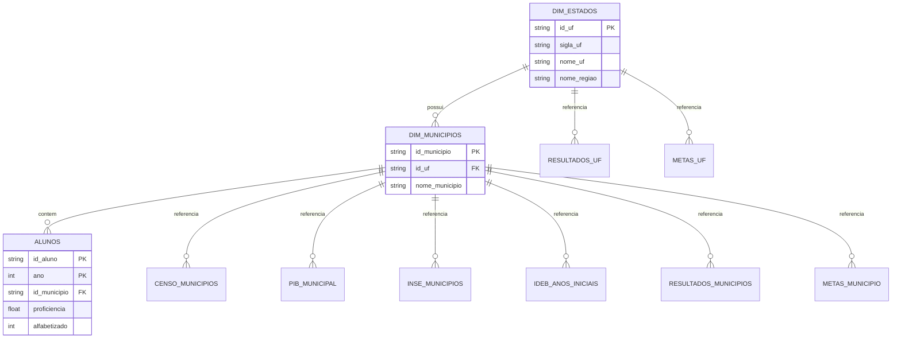

Metodologia

O projeto segue uma pipeline reproduzível, desde a obtenção dos dados públicos até a interpretação dos modelos.


1. Pipeline de pré-processamento


Preparação dos dados

Os arquivos originais são preservados em data/bronze/. A camada Silver padroniza nomes, tipos, categorias e chaves, consolidando as edições de 2023, 2024 e 2025.

A Gold organiza os dados nos principais grãos analíticos:

aluno;
município e rede;
indicador municipal;
metas municipais e estaduais;
evolução temporal.

As bases são enriquecidas com resultados e metas de alfabetização, histórico do Ideb, INSE 2023, Censo Demográfico 2022 e PIB municipal.

Regra do indicador

O universo avaliado considera alunos presentes e com prova preenchida. O percentual municipal é calculado pela média ponderada com o peso amostral:

===================

indicador =
soma dos pesos dos alfabetizados
÷
soma dos pesos dos avaliados
× 100

====================

Alunos ausentes permanecem na Gold para auditoria, mas ficam fora do denominador do indicador e do treinamento do modelo individual.

Alinhamento temporal

Para evitar vazamento, cada previsão utiliza somente informações disponíveis antes do resultado do ano-alvo t:

indicador e participação de t-1;
meta pactuada para t;
última edição do Ideb anterior a t;
INSE 2023, Censo 2022 e PIB 2021 como contextos estáticos.

O Ideb segue este alinhamento:

Ano-alvo	Último Ideb permitido2023	2021
2024	2023
2025	2023
2026	2025

A proficiência do aluno, o resultado municipal do próprio ano e outras variáveis contemporâneas ao alvo são bloqueados nos modelos.

Bases analíticas

São construídas duas ABTs principais:

ABT de aluno: uma linha por aluno avaliado, com rede, contexto escolar, histórico municipal e variáveis socioeconômicas e territoriais;
ABT de município: uma linha por município e ano-alvo, com histórico do indicador, meta, Ideb, INSE, população e variáveis econômicas.

Na ABT do aluno:

alfabetizado é a variável-alvo;
peso é usado como peso amostral;
proficiencia não entra como feature;
identificadores são usados apenas para integração, auditoria e agrupamento.
Pré-processamento

O pré-processamento fica dentro de um Pipeline do scikit-learn, garantindo que todas as transformações sejam ajustadas somente no treino.

O ColumnTransformer aplica:

mediana, indicador de ausência e padronização no histórico;
mediana, log1p e padronização em porte e renda;
mediana e padronização nas demais numéricas;
imputação e one-hot encoding em sigla_uf e rede.
Modelo do aluno

O modelo estima a probabilidade de o aluno ser alfabetizado.

A separação principal é temporal:

==============

2023 → treino
2024 → validação
2025 → teste final

==============

A validação interna agrupa os registros por município. O peso amostral do Inep é usado no ajuste e nas métricas, mas não como variável preditiva.

São comparados:

Dummy Classifier;
regressão logística;
Random Forest;
Gradient Boosting ou LightGBM.

O algoritmo, os hiperparâmetros e o limiar operacional são escolhidos na validação. O teste de 2025 é consultado apenas ao final.

Modelo municipal

O modelo municipal estima o percentual futuro de alfabetização. O risco é calculado comparando a previsão com a meta:

===========

em risco = indicador previsto < meta do ano

============

O desempenho temporal é avaliado pelo backtest de 2024 para 2025. Após essa avaliação, o modelo pode ser reajustado com os dados mais recentes para produzir uma projeção de 2026.

Perfis territoriais

Os municípios são agrupados por características educacionais, socioeconômicas, territoriais e econômicas.

O número de perfis é definido com base em:

método do cotovelo;
silhueta;
índice Davies-Bouldin;
estabilidade e interpretação dos grupos.

K-Means é comparado com agrupamento hierárquico, e PCA é usado para visualização.

Avaliação e robustez

O modelo do aluno é avaliado por AUC-ROC, AUC-PR, precisão, recall, F1, calibração e matriz de confusão. O recall de alunos não alfabetizados recebe atenção especial por representar o grupo prioritário para intervenção.

O modelo municipal é avaliado por MAE, RMSE, R², Spearman, viés e capacidade de identificar municípios que não atingirão a meta.

Também são aplicados:

comparação com baselines simples;
alvo embaralhado;
auditoria de vazamento;
bootstrap por município;
avaliação por UF;
análise de calibração;
teste temporal.
Interpretabilidade

Os modelos são explicados com SHAP e importância por permutação. Os resultados mostram associações e dependências do modelo, não relações causais.

As explicações incluem:

importância global;
contribuição por bloco;
direção das associações;
explicações locais;
tradução das variáveis técnicas para nomes de negócio.
Limitações

O projeto possui três anos do indicador, o que não permite uma modelagem clássica de séries temporais por município. Os códigos de escola são mascarados e podem não persistir entre edições. Além disso, INSE, Censo e PIB possuem diferentes anos de referência.

As previsões devem ser usadas como apoio à priorização e investigação, não como diagnóstico individual ou evidência causal.

Mais detalhes estão disponíveis em:

============

docs/fontes_de_dados.md
docs/dicionario_de_dados.md
docs/decisoes_analiticas.md
docs/metodologia.md

============

Principais mudanças: reduzi repetições, mantive apenas as regras essenciais de dados, temporalidade, modelagem, avaliação e interpretabilidade, e direcionei os detalhes técnicos para a documentação complementar.

=========== 
Obs: a planilha municipal está em formato longo

ano_da_avaliacao
percentual_de_alunos_alfabetizados_1
nivel_alfabetizacao
percentual_de_participacao

Ou seja, o ano está em uma coluna separada, e não no nome da coluna do indicador. Corrigi o notebook para usar ano_da_avaliacao como ano e percentual_de_alunos_alfabetizados_1 como resultado.


================

# Tech Challenge – Predição e Inteligência Analítica para Alfabetização no Brasil

## Objetivo
Desenvolver um modelo supervisionado capaz de prever a variável **alfabetizado** a partir de dados educacionais, socioeconômicos, demográficos, econômicos e territoriais integrados na camada Silver.

---

# Contexto do Problema

A alfabetização infantil é um dos principais indicadores de desenvolvimento educacional do país. O projeto busca transformar dados públicos em inteligência analítica para apoiar decisões de gestores públicos.

Principais perguntas de negócio:

- Quais fatores mais impactam a alfabetização?
- Quais municípios apresentam maior risco educacional?
- Quais municípios têm maior probabilidade de não atingir metas futuras?
- Quais variáveis possuem maior influência nos modelos preditivos?

---

# Arquitetura de Dados

## Camada Silver

### Avaliação
- alunos.parquet
- municipio.parquet
- uf.parquet

### Dimensões
- dim_estados.parquet
- dim_municipios.parquet

### Demografia
- censo_2022_municipios.parquet

### Economia
- pib_municipal.parquet

### Socioeconomia
- inse_2023_municipios.parquet

### Indicadores Educacionais
- ideb_anos_iniciais.parquet

### Metas
- meta_brasil.parquet
- metas_municipio.parquet
- metas_uf.parquet

### Resultados Oficiais
- resultados_municipios.parquet
- resultados_uf.parquet

---

# Variável Alvo

```text
alfabetizado
```

Valores:

- 0 = Não alfabetizado
- 1 = Alfabetizado

Origem:

```text
alunos.parquet
```

---

# Principais Features

## Demográficas

- area_km2
- densidade_hab_km2
- populacao
- nome_regiao
- sigla_uf

## Econômicas

- pib_mil_reais
- vab_agro_mil_reais
- vab_industria_mil_reais
- vab_servicos_mil_reais
- vab_adm_publica_mil_reais

### Features derivadas

- pib_per_capita
- participacao_agro_pct
- participacao_industria_pct
- participacao_servicos_pct
- participacao_adm_publica_pct

## Socioeconômicas

- media_inse
- pc_nivel_1
- pc_nivel_2
- pc_nivel_3
- pc_nivel_4
- pc_nivel_5
- pc_nivel_6
- pc_nivel_7
- pc_nivel_8

## Educacionais

- ideb_observado
- ideb_meta
- ideb_nota_media
- ideb_nota_portugues
- ideb_nota_matematica
- aprovacao_ai_pct
- aprovacao_1ano_pct
- aprovacao_2ano_pct

---

# Tratamento de Data Leakage

As seguintes variáveis representam resultados da própria avaliação e não devem ser utilizadas para prever o mesmo ano:

- indicador_pct
- vl_media_lp
- pc_aluno_nivel_0_lp
- pc_aluno_nivel_1_lp
- pc_aluno_nivel_2_lp
- pc_aluno_nivel_3_lp
- pc_aluno_nivel_4_lp
- pc_aluno_nivel_5_lp
- pc_aluno_nivel_6_lp
- pc_aluno_nivel_7_lp
- pc_aluno_nivel_8_lp

Quando utilizadas, devem ser defasadas (t-1).

---

# Estratégia de Modelagem

## Baseline

- DummyClassifier
- LogisticRegression

## Modelos candidatos

- RandomForestClassifier
- XGBoost
- LightGBM
- CatBoost

---

# Avaliação

## Métricas

- Accuracy
- Precision
- Recall
- F1 Score
- ROC AUC

## Validação

- Train/Test Split
- Cross Validation
- GroupKFold por município
- Holdout final

---

# Interpretabilidade

## Feature Importance

Identificação das variáveis de maior contribuição para o modelo.

## SHAP

Explicação local e global das predições.

---

# Estrutura do Projeto

```text
tech-challenge-fase3
├── data
│   ├── silver
│   └── gold
├── notebooks
├── src
│   ├── preprocessing
│   ├── modeling
│   ├── evaluation
│   └── visualization
├── reports
├── images
├── README.md
├── requirements.txt
└── .gitignore
```

---

# Instruções de Execução

## Criar ambiente

```bash
python -m venv .venv
```

### Linux/Mac

```bash
source .venv/bin/activate
```

### Windows

```bash
.venv\\Scripts\\activate
```

## Instalar dependências

```bash
pip install -r requirements.txt
```

## Executar construção da Gold

```bash
python src/etl/silver_to_gold.py
```

## Executar notebooks

```bash
jupyter lab
```

---

# Diagrama ER (Mermaid)


